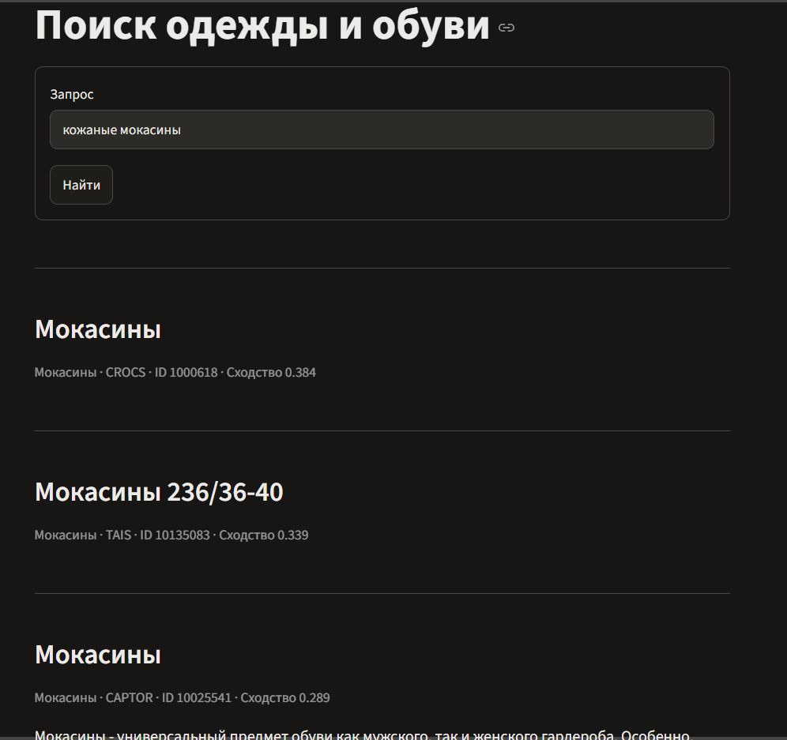

# Семантический поиск товаров

Поиск одежды и обуви по текстовому запросу. Сравниваем TF-IDF и MiniLM, затем проверяем бренд в тексте, символьные n-граммы и гибридный поиск.

Решение находится в semantic_search_project.ipynb, выводы и ответы на вопросы QA - в semantic_search_project_workbook.md.

## Данные

В папке data/ используются четыре файла:

- wb_products_raw_sample.parquet
- wb_products_dedup.parquet
- queries_synthetic_train.parquet
- queries_synthetic_test.parquet

Если файлов нет, ноутбук скачивает их из s3-ds-source. Для этого нужно указать в RECSYS_CREDENTIALS путь к JSON с ключами student_s3.access_key и student_s3.secret_key.

## Запуск

Python 3.12, CPU. Установить зависимости:

```powershell
python -m venv .venv
.\.venv\Scripts\python.exe -m pip install -r requirements.txt
```

Открыть semantic_search_project.ipynb с ядром из .venv и выполнить ячейки по порядку. Модель скачивается при первом запуске, эмбеддинги сохраняются в artifacts/. Результаты третьей недели записываются в artifacts/week3/.

Перед повторным запуском без финального test установить RUN_FINAL_TEST_EVAL = False. Вариант для финальной оценки выбран по NDCG@10 на train.

## Streamlit

Приложение ищет по 4 256 карточкам пула оценки и показывает до 10 товаров по запросу. Используется TF-IDF с брендом, лучший вариант по NDCG@10 на train. Векторизатор обучается на всём подготовленном каталоге одежды и обуви.

После установки зависимостей один раз подготовьте файлы поиска из корня проекта:

```powershell
.\.venv\Scripts\python.exe prepare_app.py
```

Нужны `data/wb_products_raw_sample.parquet` и `data/wb_products_dedup.parquet`. Если файлов нет, скрипт скачает их из S3 по ключам из `RECSYS_CREDENTIALS`. При отсутствии этой переменной скрипт ищет `../.local/credentials.json`.

Скрипт сохраняет `catalog.parquet`, `vectorizer.joblib` и разреженную матрицу `vectors.npz` в `artifacts/app/`. Если файлы уже подготовлены на другом компьютере, скопируйте все три вместе в эту папку.

Запуск:

```powershell
.\.venv\Scripts\python.exe -m streamlit run app.py --server.address 127.0.0.1
```

Примеры запросов: «кожаные мокасины», «лонгсливы love2wait». В выдаче видны название, категория, бренд, ID, сходство и часть описания.



## Результаты

Оценка проведена на 700 train-запросах и общем пуле из 4 256 карточек. Бинарный порог релевантности - 2, значения K - 1, 3, 5, 10.

| Подход | NDCG@10 | Recall@10 | Precision@5 | MRR |
|---|---:|---:|---:|---:|
| TF-IDF | 0.4315 | 0.2869 | 0.0697 | 0.1769 |
| MiniLM | 0.1512 | 0.1378 | 0.0480 | 0.1233 |
| TF-IDF с брендом | 0.4722 | 0.4784 | 0.1297 | 0.2899 |
| Символьный TF-IDF | 0.4303 | 0.3520 | 0.0737 | 0.1787 |
| Гибрид | 0.4362 | 0.3132 | 0.0746 | 0.1851 |

На test выбранный по train TF-IDF с брендом получил NDCG@10 0.4439, Recall@10 0.4545, Precision@5 0.1187, MRR 0.2644.

## MLflow

Чтобы записать эксперименты локально, указать в .env `LOG_MLFLOW=1` и `MLFLOW_TRACKING_URI=sqlite:///mlflow.db`. Если логирование не нужно, оставить `LOG_MLFLOW` незаданной.

Проверка локальных прогонов:

```powershell
$env:MLFLOW_TRACKING_URI = 'sqlite:///mlflow.db'
.\.venv\Scripts\python.exe check_mlflow.py wb-semantic-search --min-runs 6
```

[Шесть прогонов в локальном MLflow](mlflow_runs.jpg).
